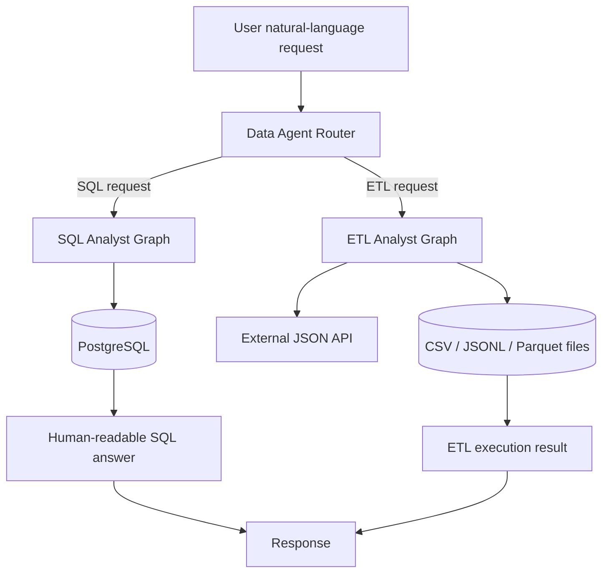
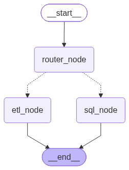
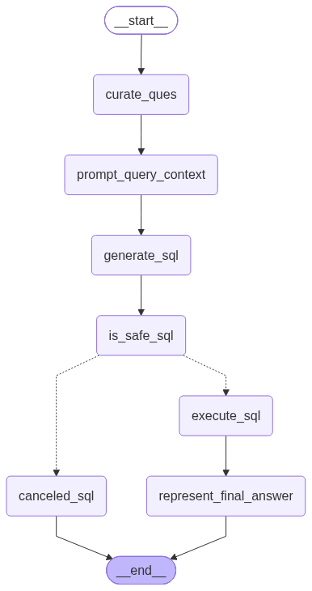
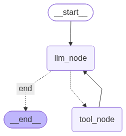
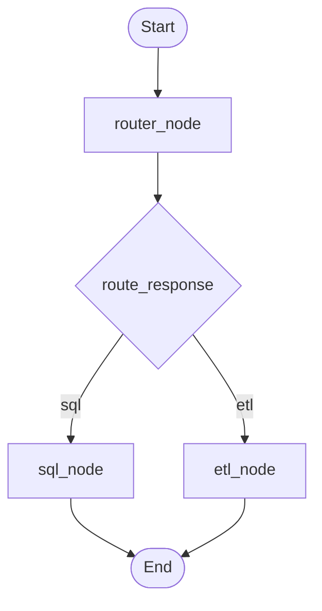
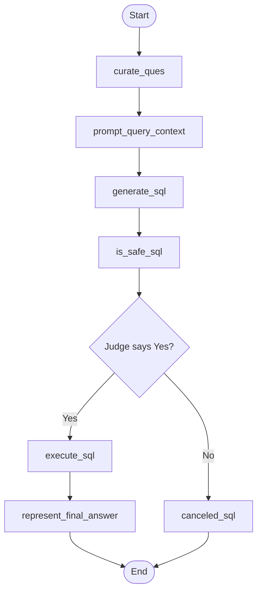
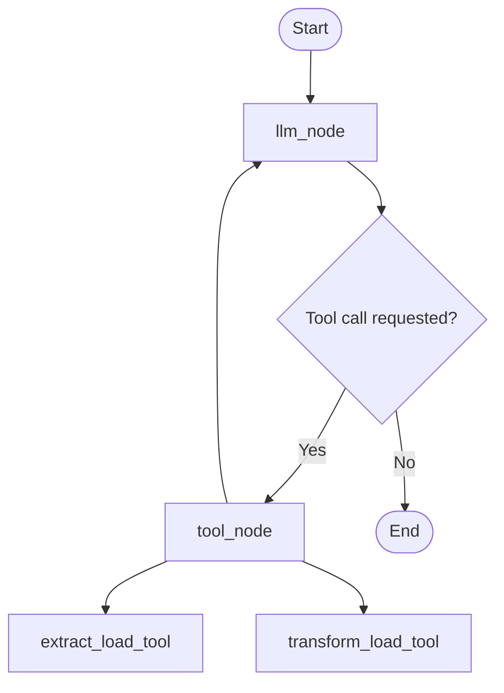
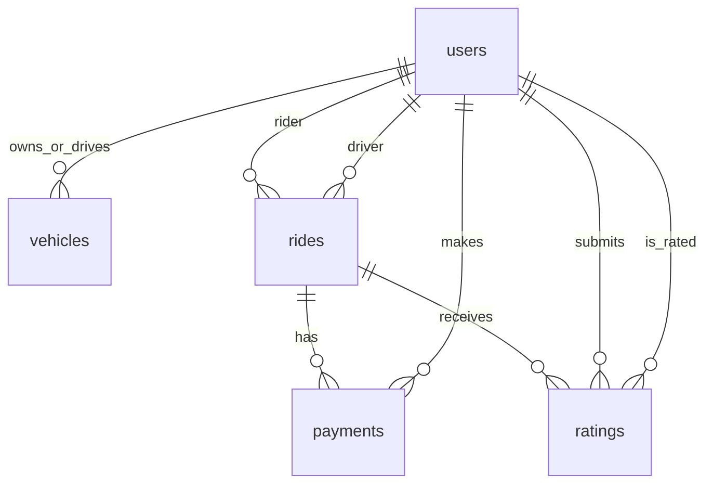

# Agentic AI Data Analyst

An LLM-powered, multi-agent data analyst that routes natural-language requests to either a **SQL Analyst** for querying a PostgreSQL database or an **ETL Analyst** for extracting and transforming datasets.

The project is built with **LangChain, LangGraph, Google Gemini, Pandas, and PostgreSQL**. Instead of asking users to write SQL or Pandas code manually, the agents interpret the request, prepare the required operation, use application tools, and return a human-readable response.

> **Project status:** This repository contains a working prototype with SQL-query and ETL workflows. Review the security and limitations section before using it with production data.

---

## Table of Contents

- [What problem does it solve?](#what-problem-does-it-solve)
- [Key capabilities](#key-capabilities)
- [Architecture at a glance](#architecture-at-a-glance)
- [How the agents work](#how-the-agents-work)
  - [1. Data Agent: request router](#1-data-agent-request-router)
  - [2. SQL Analyst](#2-sql-analyst)
  - [3. ETL Analyst](#3-etl-analyst)
- [Tool calling: who does what?](#tool-calling-who-does-what)
- [Database design](#database-design)
- [Project structure](#project-structure)
- [Technology stack](#technology-stack)
- [Prerequisites](#prerequisites)
- [Installation and setup](#installation-and-setup)
- [Configure environment variables](#configure-environment-variables)
- [Prepare the PostgreSQL database](#prepare-the-postgresql-database)
- [Run the project](#run-the-project)
- [Example requests](#example-requests)
- [Current limitations and security considerations](#current-limitations-and-security-considerations)
- [Possible future improvements](#possible-future-improvements)
- [Author](#author)

---

## What problem does it solve?

Working with data often requires a user to know SQL, understand database schemas, write Python/Pandas transformations, and manage input and output files.

This project explores how an agentic AI workflow can make those tasks accessible through natural language.

A user can ask questions such as:

- “Which payment methods are used in the database?”
- “Show me the top 10 drivers by completed rides.”
- “Extract data from this API and save it as CSV.”
- “Filter the source dataset to keep only Bulbasaur records.”

The application classifies the request and sends it to the relevant specialist workflow.

## Key capabilities

- **Natural-language routing:** a Gemini-powered router classifies a request as either SQL or ETL work.
- **Text-to-SQL workflow:** converts a natural-language question into a PostgreSQL query using live schema context.
- **Schema-aware prompting:** retrieves table names, column names, data types, and sample rows to give the SQL-generating model database context.
- **SQL safety review:** sends generated SQL to a structured-output LLM judge before execution.
- **Database execution:** runs an approved query against PostgreSQL and passes the result to an LLM for a readable answer.
- **API extraction:** fetches JSON data from an API and can save normalized records as CSV, JSON Lines, or Parquet.
- **Pandas-based transformation:** uses an LLM to generate Pandas code based on the user's transformation request and a preview of the input data.
- **Graph-based orchestration:** uses LangGraph nodes and conditional edges to control the flow between routing, analysis, and tools.

---

## Architecture at a glance

The top-level Data Agent is the entry point. It decides which specialist graph should handle the request.



### Repository architecture diagrams

The repository also includes graph images generated from the LangGraph workflows:

| Graph | Diagram |
|---|---|
| Top-level Data Agent |  |
| SQL Analyst |  |
| ETL Analyst |  |

---

## How the agents work

### 1. Data Agent: request router

**Implementation:** `agents/data_agent.py`

The Data Agent is the coordinator. It does not directly perform SQL queries or Pandas transformations. Its main responsibility is to classify the latest user message and delegate the task.

Workflow:

1. The user request enters the Data Agent graph.
2. `router_node` reads the latest message.
3. A Gemini model with `RouterSchema` structured output classifies the request as `sql` or `etl`.
4. `route_edge` checks the classification.
5. The graph conditionally invokes `sql_node` or `etl_node`.
6. The selected specialist agent processes the request and returns its response.



The router uses a Pydantic model to constrain the classification:

- `answer`: either `sql` or `etl`
- `comments`: explanation or feedback about the classification

This structured response makes the routing decision easier for the application to consume than unrestricted text.

### 2. SQL Analyst

**Implementation:** `agents/sql_analyst.py`

The SQL Analyst translates a user's question into a PostgreSQL query, checks the generated query with an LLM-based safety judge, executes a query that passes the judge, and generates a natural-language response.

#### SQL workflow



#### Step-by-step explanation

1. **Question curation — `curate_ques`**  
   The user's original question is sent to Gemini to make it clearer and more suitable for SQL generation. The curated question is stored in the graph state.

2. **Schema and prompt preparation — `prompt_query_context`**  
   The agent creates a database connection through `DatabaseUtil` and calls `schema_details("public")`. The schema context includes:
   - Table names
   - Column names
   - Column data types
   - Up to five sample rows per table

   This context is included in the prompt so the model can generate SQL that matches the actual database structure. The prompt also asks for a maximum of 10 rows unless the user specifies a different limit.

3. **SQL generation — `generate_sql`**  
   Gemini generates a PostgreSQL query from the curated question and schema context. `clean_sql_query` removes surrounding Markdown code fences if the model includes them.

4. **Safety review — `is_safe_sql`**  
   The generated query is passed to another Gemini call using the Pydantic `JudgeSchema`. The judge returns:
   - `answer`: `Yes` or `No`
   - `comments`: its reasoning

5. **Conditional execution**  
   `is_safe_sql_edge` checks the judge's answer:
   - `Yes` routes to `execute_sql`.
   - `No` routes to `canceled_sql`, which creates a message explaining that execution was blocked.

6. **Query execution — `execute_sql`**  
   `DatabaseUtil.execute_sql` opens a PostgreSQL connection and executes the generated SQL. The execution result is saved in the graph state.

7. **Final response — `represent_final_answer`**  
   Gemini receives the query result and the curated question, then produces a concise, user-friendly answer without exposing SQL implementation details.

#### SQL Analyst state

`Models/schema.py` defines `AgentSchema`, which carries the information between graph nodes:

| State field | Purpose |
|---|---|
| `message` | Conversation messages |
| `user_question` | Original user request |
| `curated_ques` | Refined version of the request |
| `prompt_query_context` | Prompt containing the question and database schema |
| `generated_sql_query` | SQL generated by the model |
| `is_safe` | Judge result: `Yes` or `No` |
| `comments` | Judge feedback |
| `sql_query_execution_result` | Database execution result |
| `final_answer` | Final natural-language response |

### 3. ETL Analyst

**Implementation:** `agents/etl_analyst.py` and `utils/etl_tools.py`

The ETL Analyst handles requests that involve extracting data from an API or transforming data already stored in a file.

ETL stands for:

- **Extract:** obtain data from a source, such as an API.
- **Transform:** clean, filter, reshape, or otherwise modify the data.
- **Load:** save the resulting data to a destination.

#### ETL workflow



The ETL graph follows a tool-calling loop:

1. `llm_node` sends the conversation context to Gemini with the available tools bound to the model.
2. Gemini decides whether a tool is required and, if so, returns a structured tool call with arguments.
3. `tool_node` finds the requested tool and invokes it.
4. The tool result is added to the message history as a `ToolMessage`.
5. Control returns to `llm_node`, which can interpret the result, call another tool, or provide a final response.
6. If no tool call is requested, the graph ends.

#### ETL tools

**`extract_load_tool(url, output_folder, format)`**

- Sends an HTTP GET request to the supplied API URL.
- Checks the HTTP response.
- Reads the response as JSON.
- Handles a top-level list, a dictionary containing a `results` list, or a single JSON object.
- Uses `pandas.json_normalize` to convert records into a tabular DataFrame.
- Saves the data in the requested format: `csv`, `json`, or `parquet`.

The JSON output is written as newline-delimited JSON (JSON Lines).

**`transform_load_tool(input_file_path, output_folder, output_format, user_question)`**

- Reads the input file and obtains a preview of its first three rows.
- Sends the file path, output destination, requested transformation, and data preview to Gemini.
- Asks Gemini to generate Pandas code for the transformation.
- Removes Markdown code fences from the returned code when present.
- Passes the generated code to `ETLTools.execute_code`.

The transformation tool is intended to support user-directed Pandas operations. The generated code is responsible for creating the DataFrame, applying the transformation, and saving the output.

**File-reading support in `transform_load_context`**

The current implementation can read:
- CSV (`.csv`)
- JSON Lines (`.json`, read with `lines=True`)
- Parquet (`.parquet`)

Parquet support may require installing an additional Pandas Parquet engine such as `pyarrow`.

---

## Tool calling: who does what?

Tool calling is a hand-off mechanism between the LLM and the Python application.

It is important to distinguish the two responsibilities:

1. **The LLM chooses and requests a tool call.** For example, it may decide that an API extraction requires `extract_load_tool` and produce the function name and arguments.
2. **The application executes the function.** In this project, `tool_node` receives the tool call, invokes the corresponding Python tool, and sends the result back to the model as a `ToolMessage`.

The model does not directly connect to PostgreSQL or execute Python code by itself. The application provides those capabilities through functions and tools.

---

## Database design

The project uses PostgreSQL and defines five related tables in the `public` schema.

| Table | Purpose | Important relationships |
|---|---|---|
| `users` | Rider and driver profile information | Primary key: `user_id` |
| `vehicles` | Vehicles associated with drivers | `driver_id` references `users.user_id` |
| `rides` | Ride requests, locations, fares, timestamps, and statuses | `rider_id` and `driver_id` reference `users.user_id` |
| `payments` | Payment details for rides | `ride_id` references `rides.ride_id`; `user_id` references `users.user_id` |
| `ratings` | Rider feedback and driver ratings | References `rides` and `users` |

The schema creation SQL and CSV-loading process are in `feed_db.py`. The database utility in `utils/database.py` retrieves schema information and executes SQL.

### Database relationships



`feed_db.py` creates indexes on commonly referenced relationship and filtering columns, including ride rider/driver IDs, ride request time, ride status, payment ride/user IDs, and rating ride/driver IDs.

---

## Project structure

```text
ola-ai-data-agent/
│
├── agents/
│   ├── data_agent.py       # Top-level router and specialist-agent delegation
│   ├── sql_analyst.py      # Natural-language-to-SQL LangGraph workflow
│   ├── etl_analyst.py      # ETL agent and tool-calling workflow
│   └── scratch.py          # Development / scratch code
│
├── Models/
│   └── schema.py           # Pydantic models used as graph state and structured output
│
├── utils/
│   ├── database.py         # PostgreSQL schema inspection and query execution
│   ├── etl_tools.py        # API extraction, file preview, and code execution helpers
│   └── llm_pick.py         # Gemini model initialization
│
├── data/
│   ├── extract/            # Extracted source data
│   ├── transform/          # Transformed output data
│   ├── users.csv
│   ├── vehicles.csv
│   ├── rides.csv
│   ├── payments.csv
│   └── ratings.csv
│
├── data_agent_graph.png   # Data Agent graph visualization
├── sql_analyst_graph.png  # SQL Analyst graph visualization
├── etl_analyst_graph.png  # ETL Analyst graph visualization
├── feed_db.py             # Creates PostgreSQL tables and imports CSV data
├── main.py                # Example application entry point
├── pyproject.toml         # Python project metadata and dependencies
├── uv.lock                # Locked dependency versions
└── README.md
```

---

## Technology stack

| Technology | Role in the project |
|---|---|
| Python 3.11+ | Main programming language |
| Google Gemini | Request classification, question curation, SQL generation, SQL review, Pandas-code generation, and final response generation |
| LangChain | Model integration, prompts, message types, and tool definitions |
| LangGraph | Stateful agent workflows, graph nodes, edges, and conditional routing |
| Pydantic | Typed state models and structured model output |
| Pandas | JSON normalization, file reading, and data transformation |
| PostgreSQL | Relational database queried by the SQL Analyst |
| Psycopg2 | Python-to-PostgreSQL connectivity |
| Requests | HTTP requests for API extraction |
| uv | Python dependency and environment management |

---

## Prerequisites

Before running the project, install:

- Python 3.11 or later
- PostgreSQL
- [uv](https://docs.astral.sh/uv/)
- A Google Gemini API key

You will also need access to a PostgreSQL database where the project tables can be created.

## Installation and setup

### 1. Clone the repository

```bash
git clone https://github.com/prashant-iiitr/ola-ai-data-agent.git
cd ola-ai-data-agent
```

### 2. Create the virtual environment and install dependencies

```bash
uv sync
```

The current source imports `requests` and `python-dotenv` functionality. If either is missing from the resolved environment, add the dependencies:

```bash
uv add requests python-dotenv
```

For Parquet input/output support, install a Pandas Parquet engine:

```bash
uv add pyarrow
```

### 3. Configure environment variables

Create a local `.env` file in the project root. Use the variable names shown in the next section. Do not commit this file.

### 4. Create and populate the PostgreSQL database

Create a PostgreSQL database, configure the connection variables, and then run:

```bash
uv run python feed_db.py
```

**Important:** `feed_db.py` creates the tables and then truncates the five project tables before importing the CSV files. Running it again will erase the existing rows in those tables and reload them from the CSV files. Use it only with a disposable/development database unless you intentionally want to replace the data.

### 5. Run the example

The current `main.py` example asks the ETL agent to filter the extracted Pokémon dataset for Bulbasaur and save the transformed data in `data/transform`.

```bash
uv run python main.py
```

The repository's `main.py` expects the source file at `data/extract/extracted_data.csv`. If it is not present, first use the ETL extraction workflow or place the expected CSV file there.

---

## Configure environment variables

The application reads Gemini and PostgreSQL settings from environment variables.

Create `.env` in the repository root:

```env
GEMINI_API_KEY=your_gemini_api_key

host=localhost
port=5432
database=your_database_name
user=your_postgres_username
password=your_postgres_password
```

Use your own local values. Never paste real API keys, database passwords, or production connection strings into a public README, source file, issue, or commit.

The `.gitignore` already excludes `.env` and `.env.*` files. Keep that protection in place.

---

## Prepare the PostgreSQL database

`feed_db.py` contains the SQL definitions for the five tables and imports the CSV files from the `data/` directory.

Run it from the repository root:

```bash
uv run python feed_db.py
```

After the script completes, connect to PostgreSQL and verify that the following tables exist:

```sql
SELECT table_name
FROM information_schema.tables
WHERE table_schema = 'public'
ORDER BY table_name;
```

Expected table names:

```text
payments
ratings
rides
users
vehicles
```

---

## Run the project

Run the top-level example:

```bash
uv run python main.py
```

You can also run an individual specialist module for development:

```bash
uv run python agents/data_agent.py
uv run python agents/sql_analyst.py
uv run python agents/etl_analyst.py
```

The SQL Analyst's standalone example asks for the payment methods present in the database. The ETL Analyst's example code includes an API extraction example using the public Pokémon API.

---

## Example requests

The following are examples of the kinds of requests supported by the implemented workflows. Exact results depend on the data loaded into your own database or source file.

### SQL Analyst examples

```text
What are the different types of payment methods in our database?
```

```text
Show the 10 most recent rides.
```

```text
Which drivers have completed the highest number of rides?
```

### ETL Analyst examples

```text
Extract data from https://pokeapi.co/api/v2/pokemon
and save it in the data/extract folder in CSV format.
```

```text
Transform data/extract/extracted_data.csv and save the result
in data/transform as CSV. Keep only Bulbasaur records.
```

---

## Current limitations and security considerations

This project is a learning/prototype implementation. The following points should be addressed before production use.

1. **Do not rely on an LLM judge as the only SQL security control.** The current SQL safety check is an LLM-based review. LLM output can be incorrect or manipulated. Enforce read-only access at the PostgreSQL role/permission level and validate SQL with a deterministic parser or query allowlist before execution.

2. **Generated Pandas code is executed with Python `exec`.** The current `execute_code` helper runs model-generated code in the application process. This is dangerous for untrusted input because generated code can potentially access files, environment variables, or other system resources. Do not expose this workflow to untrusted users or production data until code execution is isolated in a restricted sandbox with resource limits and a strict allowlist.

3. **Use least-privilege database credentials.** The application should connect with a dedicated read-only database role for analyst queries. Do not use a PostgreSQL superuser account for normal agent execution.

4. **Protect secrets.** Keep API keys and database credentials in environment variables or a secrets manager. Never hardcode them in Python files or commit `.env` files.

5. **Validate generated SQL and parameters.** Add deterministic validation, statement restrictions, query timeouts, row limits, and safe handling of database errors. Avoid exposing raw internal errors to end users.

6. **Validate API and file inputs.** Add request timeouts, response-size limits, URL restrictions, file-path validation, and clear error handling. The current extraction helper does not set an explicit HTTP timeout.

7. **Check data privacy.** Schema context currently includes sample database rows in the prompt sent to Gemini. Do not send personal, confidential, or regulated data to an external model unless the data handling and provider configuration have been reviewed and approved.

8. **Review database initialization behavior.** `feed_db.py` truncates the project tables before loading CSVs. Do not run it against a database containing data you need to preserve.

9. **Add automated tests and observability.** The current repository does not show a comprehensive automated test suite, retry policy for all tools, or production monitoring.

---

## Possible future improvements

- Add deterministic SQL parsing and enforce `SELECT`-only execution.
- Run database queries through a dedicated read-only PostgreSQL role.
- Replace unrestricted `exec` with a sandboxed transformation runtime.
- Add schema-aware SQL validation and query explain plans.
- Add support for more data sources and destinations.
- Add transformation previews, data-quality checks, and before/after summaries.
- Add unit and integration tests for each graph node and tool.
- Add structured logging, tracing, retries, and clearer error handling.
- Add a web interface or API endpoint for submitting natural-language requests.
- Add conversation memory and multi-turn clarification for ambiguous requests.

---

## Author

**Prashant Kumar**  
B.Tech — Computer Science and Engineering  
Indian Institute of Information Technology, Raichur

GitHub: [@prashant-iiitr](https://github.com/prashant-iiitr)

---

## Acknowledgements

Built as an exploration of agentic AI workflows, natural-language data analysis, LangChain, and LangGraph.
